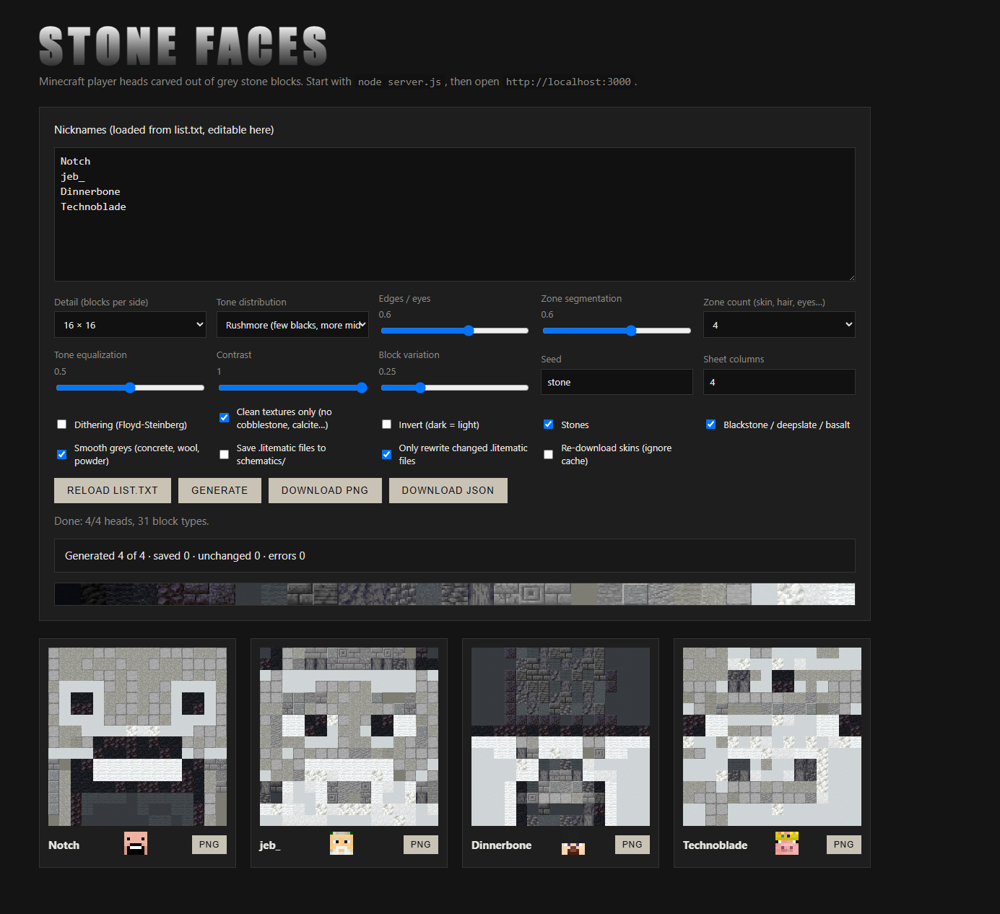

# Stone Faces

Turn Minecraft player heads into portraits built from grey and black stone blocks, a bit like Mount Rushmore or the Naruto Hokage faces. Give it a list of nicknames and it fetches each skin, maps it to blocks, and exports a PNG, a JSON file and a Litematica schematic per player.

Everything is vanilla-obtainable and strictly greyscale: stone, andesite, deepslate, basalt, blackstone, grey concrete and wool, and so on. No bedrock, obsidian or end stone, and anything with a colour tint gets filtered out.



## Quick start

You need [Node.js](https://nodejs.org) 18 or newer. There are no dependencies to install.

```
node server.js
```

Open <http://localhost:3000>, put your nicknames in the box (or in `list.txt`) and hit **Generate**.

To use your own list, copy `list.example.txt` to `list.txt`. `list.txt` is git-ignored; if it doesn't exist the example list is used.

## Output

- **PNG**: a sheet with every head, downloadable from the page (each card also has its own PNG button).
- **JSON**: the block grid of every head plus the palette and the options used.
- **`.litematic`**: one file per nickname in `schematics/`, a flat wall one block deep, ready for [Litematica](https://github.com/maruohon/litematica). Targets Minecraft 1.21.1.

## Options

| Option | What it does |
| --- | --- |
| Detail | 8×8 up to 48×48 blocks per head. The skin is upscaled with nearest neighbour, so pixels stay crisp. |
| Tone distribution | Rushmore (few blacks, more mid greys), real luminance, or even. |
| Edges / eyes | Unsharp mask that keeps eyes, mouth and hair outlines readable. |
| Zone segmentation | Clusters the skin into zones (skin, hair, eyes…) and gives each zone its own band of tones. |
| Tone equalization | Spreads each head's tones over the whole palette. |
| Dithering | Floyd-Steinberg error diffusion. Off by default, it can leave dots on flat areas. |
| Clean textures | Drops noisy blocks like cobblestone, diorite and calcite. |
| Block groups | Toggle stones, dark blocks, and smooth greys (concrete, wool, powder). |

Skins are cached in `cache/heads/` for 24 hours. By default only the `.litematic` files whose result changed are rewritten, and a summary at the end lists generated, saved, unchanged and failed nicknames (unknown nicknames and failed downloads are reported, not fatal).

## How it works

1. The server checks the nickname with the Mojang API and downloads the head from minotar.net (mc-heads.net as a fallback).
2. The browser turns the head into a luminance map, stretches and equalizes it, blends in the zone tones, and sharpens edges.
3. Each pixel is matched to the block with the closest brightness, with a seeded random pick among near-equal blocks so the wall doesn't look flat.
4. The grid is drawn with the block textures and sent to the server, which writes the `.litematic`.

Block textures come from [InventivetalentDev/minecraft-assets](https://github.com/InventivetalentDev/minecraft-assets) through jsDelivr, so you need an internet connection.

## Project layout

- `server.js`: static server, skin proxy and cache, `.litematic` saving
- `app.js`: palette loading and the image to blocks algorithm
- `blocks.js`: the block catalogue
- `litematic.js`: small NBT writer for the Litematica format
- `index.html`, `style.css`: the UI

## Disclaimer

Not affiliated with Mojang or Microsoft. Minecraft is a trademark of Mojang AB. Block textures belong to their owners and are loaded at runtime, not bundled with this repo.

## License

[MIT](LICENSE)
